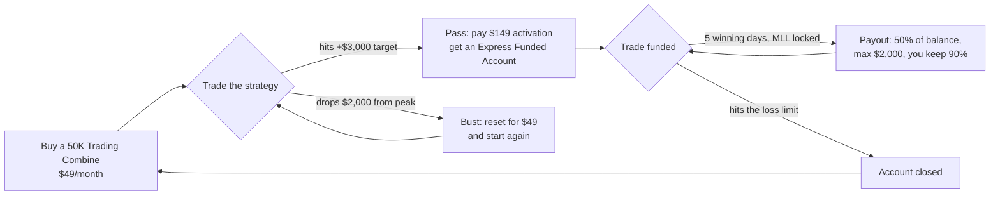

# LONG-CONVEXITY — prop-firm account recycling on Topstep

**This is not a trading strategy that is expected to make money by itself.**
It is a system for running a business on top of a prop firm's account
structure: buy cheap Topstep evaluations, trade them with one fixed,
automated NQ futures strategy, take payouts from the ones that pass, and
replace each account when it blows up.

The idea in one line: **losses are capped at small fees, while the upside is
real payouts.** A $49 evaluation that fails costs $49. One that passes can pay
out thousands. The strategy does not need to beat the market by much. It
needs to pass evaluations a bit more often than chance does, and keep funded
accounts alive long enough to be paid.

> Status (2026-11): **backtest and paper forward-log only.** The first real
> account (one Topstep 50K) is being set up. No figure here is a track record.

---

## How the recycling works



Every funded account eventually dies: in the backtest, 53 of 53 did, after a
median of 11 trades [N10]. The model treats that as normal running cost. What
matters is whether, over many cycles, **money withdrawn > money spent on
evaluations, resets and fees**.

---

## The numbers (backtest, NQ, Jan 2016 – Oct 2026)

One account at a time, $900 risked per trade, Topstep's rules as read on
2026-11-07. Every figure has a reproducible command in
[docs/FIGURES_LEDGER.md](docs/FIGURES_LEDGER.md) (row in brackets).

| | |
|---|---|
| Evaluations bought / passed / payouts | 152 / 52 / 44 [C1] |
| Pass rate | 34.4% [C3] |
| Withdrawn | $61,440 [C2] |
| Spent (subscriptions, resets, activations, API access) | $17,081 [C2] |
| **Net** | **$44,359** (about $340 a month) [C2] |
| Same trades with a **coin-flip** direction (median of 200) | $18,046 [C6] |
| The strategy alone, no recycling | −$2,553, roughly break-even [C7] |
| Unseen 2010–2015 holdout | −$2,505 [C8] |
| Deepest cash dip before recovering: typical / worst start | −$863 / −$3,520 [C4] |
| Time to first payout: typical / 1 in 10 | 144 days / 826 days [C5] |

How to read this:

- **Most of the result comes from the account structure, not the trades.**
  Traded alone, the strategy roughly breaks even. Even random directions with
  the same trade sizes net about $18K, because failures are cheap and payouts
  aren't. The strategy adds about $26K on top of that.
- **That extra edge is NQ-specific.** Run unchanged on other index futures
  (each test pre-registered), it beats a coin flip on NQ 98% of the time, YM
  96%, ES 86% and RTY 12% [Y6]. On the unseen 2010–2015 holdout it lost
  $2,505, mostly to fees, which were a far larger share of each trade's risk
  when NQ traded at lower prices.
- **Income is lumpy.** Only about 20% of months have a payout [K5]. Plan
  around a cash reserve, not a monthly figure.
- **Honest expectation: about $0–3,000 a year per 50K account.** It is not a
  salary.

---

## Plan and risk rules

| | |
|---|---|
| Account | Topstep 50K Trading Combine, Standard path, NQ via MNQ micros |
| Risk per trade | $900 (re-tested; larger sizes failed the pre-registered rule) |
| Payout policy | `LOCK_FIRST`: no payout until the loss limit has locked at $0 |
| Cash reserve | **$3,600**, the stop line: if net spending reaches it, stop and review (the worst historical start needed $3,520) |
| Scaling | 1 account → 5 (Topstep's cap) only after 3–6 months of real results match the backtest |
| Where it runs | On the account holder's **own computer**. Topstep prohibits VPS, VPNs and remote servers for order routing |

Topstep's written answer on automation (2026-09-10, in
[docs/topstep_automation_enquiry.md](docs/topstep_automation_enquiry.md)):
automation through the TopstepX API is **allowed** in the Trading Combine (test
it on a Practice account first) and in the Express Funded Account, and **not
allowed** in the Live Funded Account.

---

## What's in the repo

| Path | What it is |
|---|---|
| [`backtest/recycle.py`](backtest/recycle.py) | **The core model.** Topstep's evaluation and funded-account rules as code: trailing loss limit and its lock, winning days, payout caps, 90/10 split, fees, resets, scaling plan, Standard and Consistency paths. |
| [`strategies/ltf_sweep.py`](strategies/ltf_sweep.py) | The one strategy that is traded: a 1-minute liquidity sweep with a 1:1 target, one trade a day, 09:30–15:00 ET. Its parameters are frozen. |
| [`backtest/engine.py`](backtest/engine.py) | Fill simulator on 1-minute bars: limit entries, stop slippage, pessimistic same-bar handling. |
| [`bridge/`](bridge/) | Live execution to TopstepX: preflight checks, guards, journal, round-trip proof that an empty book really is empty. |
| [`scripts/`](scripts/) | Every report and test behind a figure. Start with `jx_checks.py`, `jx_capital.py`, `jx_zero_edge.py`. |
| [`docs/FIGURES_LEDGER.md`](docs/FIGURES_LEDGER.md) | Every standing figure, with its command. **A number not in the ledger is not a standing figure.** |
| [`docs/CANDIDATES.md`](docs/CANDIDATES.md) | Every strategy idea tried (28 rows, about 940 configurations) and its verdict. |
| [`docs/forward_log.csv`](docs/forward_log.csv) | Paper forward log: every signal since 31 August 2026 and how it ended, appended monthly by GitHub Actions. |
| [`docs/README.md`](docs/README.md) | Index of every other document. |

Several of the operating docs (`GO_LIVE.md`, `bridge/README.md`) are in
Chinese, as written in the upstream project.

---

## Run it

```bash
uv venv && uv pip install -e ".[dev]"
uv run python scripts/ingest.py               # merge and validate the 1-minute NQ data
uv run pytest                                 # 464 tests
uv run python scripts/jx_checks.py            # headline recycling figures, by year, rule stress test
uv run python scripts/jx_capital.py           # pass rate, cash needed, time to first payout
uv run python scripts/jx_zero_edge.py         # the coin-flip baseline
uv run python scripts/recycling_report.py     # HTML report of the account chain
```

Data: Databento GLBX.MDP3 1-minute bars, 2010-06 → 2026-10, for NQ, ES, YM and
RTY, stored in `data/raw/` ([docs/DATABENTO_README.md](docs/DATABENTO_README.md)).
`.github/workflows/monthly.yml` fetches the new month, appends the forward log
and re-runs the checks on the 2nd of every month.

---

## How results are kept honest

- **Pre-registration.** Every test since November 2026 had its rules committed
  before it ran ([HOLDOUT](docs/HOLDOUT_PREREG.md), [ES](docs/ES_PREREG.md),
  [YM/RTY](docs/PREREG_YM_RTY.md), [idea batch](docs/PREREG_BATCH_20261109.md)).
  Results are appended once; the rules above them don't change.
- **Coin-flip baseline.** An idea counts only if it beats the money the account
  structure would pay anyway.
- **Out-of-sample checks.** An unseen 2010–2015 holdout and three other markets.
- **Known traps documented.** One bar of look-ahead once produced a fake
  +$197K. Fills at prices the market had already left inflated another
  result. Both are now covered by tests ([STRATEGY_RESEARCH_zh.md](docs/STRATEGY_RESEARCH_zh.md)).
- **Negative results kept.** Of 12 improvement ideas tested on 2026-11-09, 11
  failed and one passed weakly. All are recorded.

## Main risks

1. **The edge may be smaller than the backtest.** It holds clearly on NQ only.
2. **Rule changes.** Topstep cut its 50K payout cap to $2,000 in April 2026.
   The model has to be re-read against Topstep's pages before every purchase.
3. **Accounts don't diversify.** Every account takes the same trade, so five
   accounts are five times the swings, not five independent bets.
4. **Execution.** Topstep does not review losses caused by software errors.
   The bridge's preflight, journal and reconciliation are the only protection.

---

Forked from [Christopher0607/ICT-HANXIN](https://github.com/Christopher0607/ICT-HANXIN)
(ICT/SMC strategy research). The recycling model, rules, tests and
pre-registered evaluations were added in this fork. Not financial advice.
