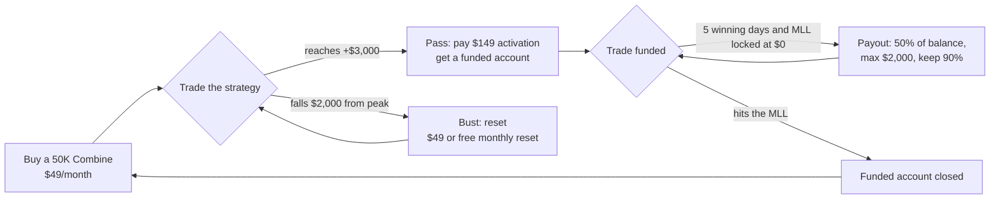

> **Results at a glance: [`docs/START_HERE.md`](docs/START_HERE.md)** — approved / disapproved prop firms, liquidation bot status, every non-prop strategy tested.

# LONG-CONVEXITY — prop-firm account recycling on Topstep

> **Repo map:** this README covers the prop-firm business. The repo also holds a separate liquidation-bot
> project and a non-prop search; see [`docs/INDEX.md`](docs/INDEX.md).

**This is not a trading strategy that is expected to make money by itself.**
It is a system for running a small business on top of a prop firm's account
rules. It buys cheap Topstep evaluations and trades them with one fixed,
automated NQ futures strategy. It takes payouts from the accounts that pass,
and replaces each account when it blows up.

The idea in one line: **losses are capped at small fees, while the upside is
real payouts.** A $49 evaluation that fails costs $49. One that passes can pay
out thousands. The strategy does not need to beat the market by much. It
needs to pass evaluations a bit more often than chance does, and keep funded
accounts alive long enough to be paid.

> **Status (2026-11):** backtest and paper forward log only. The first real
> account, one Topstep 50K, is being set up. Nothing here is a track record.

## Contents

1. [How a prop firm works, and the rules this models](#1-how-a-prop-firm-works-and-the-rules-this-models)
2. [The recycling loop](#2-the-recycling-loop)
3. [Why it can make money: the economics](#3-why-it-can-make-money-the-economics)
4. [Results](#4-results)
5. [What the result depends on](#5-what-the-result-depends-on)
6. [The trading strategy](#6-the-trading-strategy)
7. [Running it live](#7-running-it-live)
8. [The plan and its risk rules](#8-the-plan-and-its-risk-rules)
9. [Scaling up](#9-scaling-up)
10. [What has been tested and ruled out](#10-what-has-been-tested-and-ruled-out)
11. [How results are kept honest](#11-how-results-are-kept-honest)
12. [What the model does not capture](#12-what-the-model-does-not-capture)
13. [Repo map and how to run it](#13-repo-map-and-how-to-run-it)
14. [FAQ](#14-faq)

Every figure below is backtest output with a reproducible command in
[docs/FIGURES_LEDGER.md](docs/FIGURES_LEDGER.md). The row is given in brackets,
e.g. [C2]. **A number not in the ledger is not a standing figure.**

---

## 1. How a prop firm works, and the rules this models

A futures prop firm sells you a **test** (Topstep calls it a *Trading
Combine*). You trade a simulated account, and if you hit a profit target
without losing more than a set amount, you get a **funded account** (an
*Express Funded Account*, XFA). There you can withdraw part of the profits. You
never deposit trading capital. Your only costs are the firm's fees.

The rules below are Topstep's 50K account as read from Topstep's own pages
(help.topstep.com, topstep.com) on 2026-11-06 and 2026-11-09. They are coded in
[`backtest/recycle.py`](backtest/recycle.py) as `XFARules`.

| Rule | 50K value | In the model |
|---|---|---|
| Combine price | $49 a month, a reset after a bust $49, and every monthly rebill includes one free reset | `monthly`, `reset` |
| Profit target to pass | +$3,000 | `profit_target` |
| Maximum Loss Limit (MLL) | $2,000 below the highest end-of-day balance; it stops trailing ("locks") at the starting balance | `loss_limit`, `combine_mll_locks` |
| Activation on passing | $149 per funded account earned | `activation` |
| Funded account | Starts at $0 with a $2,000 trailing MLL that **locks at $0** once the balance reaches +$2,000 | `funded_loss_limit`, `mll_locks_at` |
| Payout eligibility | 5 winning days of $150+ since the last payout, plus profit since the last payout | `winning_days_required`, `profit_since_payout_required` |
| Payout size | Up to 50% of the balance, **capped at $2,000** per request (cut from higher caps in April 2026) | `payout_share`, `payout_cap` |
| After a payout | The MLL resets to $0 permanently | `payout_locks_mll` |
| Profit split | Trader keeps 90% | `profit_split` |
| Position size | 50 micros in the Combine; funded starts at 20 micros and scales up with the balance | `combine_max_contracts`, `scaling_tier` |
| Funded accounts at once | 5 per person | — |
| API access (TopstepX) | $14.50 a month | `api_monthly` |

**Automation.** Topstep answered in writing on 2026-09-10
([docs/topstep_automation_enquiry.md](docs/topstep_automation_enquiry.md)):
trading through the TopstepX API is **allowed** in the Combine (test it on a
Practice account first) and in the Express Funded Account, and **not allowed**
in the Live Funded Account. All orders must come from the trader's **own
device**: VPS, VPNs and remote servers are prohibited. Losses caused by
software errors are not reviewed.

Prop-firm rules change often. The model has to be re-read against Topstep's
pages before every purchase.

---

## 2. The recycling loop



In words:

1. **Buy a test.** Trade it with the strategy, one trade a day.
2. **Most tests fail.** About two in three bust [C3]. A bust costs one $49
   reset, often nothing extra because each month's subscription includes a
   free reset.
3. **About one in three passes.** Pay $149 and get a funded account.
4. **Grow the funded account to +$2,000.** At that point its loss limit locks
   at $0. The plan waits for the lock before the first payout (the
   `LOCK_FIRST` policy, see section 8).
5. **Take payouts** every time there are 5 winning days, up to $2,000 each.
6. **Eventually the funded account dies.** In the backtest every funded
   account eventually closed, after a median of 11 trades [N10]. Then go
   back to step 1.

So funded accounts are not assets to protect. They are tickets that pay out a
few times before expiring. The business works if, over many cycles,
**money withdrawn > money spent**.

---

## 3. Why it can make money: the economics

Averaged over the 2016–2026 backtest [C11]:

> **Each evaluation bought costs about $112 in fees and brings back about
> $404 in withdrawals.**

That gap exists for two reasons, and only one of them is the strategy.

**The structure is lopsided.** A failed test can only cost fees. A passed test
can pay out several times. Even trading at random, some tests pass and some
of those pay out. With the same trade sizes and **random direction**, the
median of 200 runs still nets **$18,046** over the backtest [C6]. That money
comes from the rules, not from any skill.

**The strategy adds a modest edge on top.** The real trades net **$44,359**
[C2], about $26K more than the coin flip. They pass 34.4% of tests against the
coin flip's 26.7% [C3, C6], and they beat 98% of coin-flip runs [Y6].

**The strategy alone, without the recycling, roughly breaks even:** −$2,553
over the same period at the same size [C7]. That is the clearest way to see
what this project is. The trades are close to a coin flip. The prop firm's
rules turn them into a business.

---

## 4. Results

**Backtest, NQ futures, January 2016 – October 2026.** One account at a time,
$900 risked per trade, Topstep rules as of 2026-11-07, `LOCK_FIRST` payouts.

| | |
|---|---|
| Evaluations bought / passed / payouts | 152 / 52 / 44 [C1] |
| Pass rate | 34.4% [C3] |
| Withdrawn | $61,440 [C2] |
| Spent (subscriptions, resets, activations, API access) | $17,081 [C2] |
| **Net** | **$44,359**, about $340 a month on average [C2] |
| Coin-flip baseline (same sizes, random direction) | $18,046 [C6] |
| Strategy alone, no recycling | −$2,553 [C7] |
| Unseen 2010–2015 holdout | −$2,505 [C8] |
| Deepest cash dip before recovering: typical / worst of 118 start months | −$863 / −$3,520 [C4] |
| Time to first payout: typical / 1 in 10 starts | 144 days / 826 days [C5] |
| Months with at least one payout | about 20% [K5] |

**Withdrawals by year** [C9]:

| 2016 | 2017 | 2018 | 2019 | 2020 | 2021 | 2022 | 2023 | 2024 | 2025 | 2026 (to Oct) |
|---|---|---|---|---|---|---|---|---|---|---|
| $0 | $0 | $0 | $4,474 | $9,734 | $1,164 | $3,342 | $11,586 | $6,596 | $10,221 | $14,322 |

Three years with no payout at all, then lumpy income. A chain started in
another month gives a different year table, which is why the capital figures
above use 118 different start months.

**Honest expectation: about $0–3,000 a year per 50K account.** It is not a
salary.

---

## 5. What the result depends on

The rule stress test in `scripts/jx_checks.py` changes one Topstep rule at a
time and re-runs the whole chain [C10]:

| Change | Net, 2016–2026 |
|---|---|
| Rules as they are | $44,359 |
| Resets cost $99 instead of $49 | $43,259 |
| $149 activation charged on every test, not just passes | $29,459 |
| Payouts need 10 winning days instead of 5 | $46,775 |
| **The funded MLL never locks** | **−$17,130** |
| All of the above at once | −$33,329 |

**The single rule everything depends on is the MLL lock.** Without it, no
funded account ever reaches a payable state under `LOCK_FIRST`. If Topstep
removes the lock, the plan stops working.

The result also depends on the market. The same strategy, unchanged, beats a
coin flip on NQ but not clearly on other index futures (section 10).

---

## 6. The trading strategy

[`strategies/ltf_sweep.py`](strategies/ltf_sweep.py), a "liquidity sweep" idea
from ICT/SMC trading, written as testable code. Every parameter was fixed
before it was first run. Nothing is tuned.

1. **Find a liquidity pool.** The highest high and lowest low of the last
   **four completed 15-minute candles**. Stop orders tend to sit just beyond
   recent extremes.
2. **Wait for a sweep.** Between **09:30 and 15:00 New York time**, a
   1-minute bar pokes at least one tick through the pool and closes back
   inside. That means the stops were taken and the move was rejected.
3. **Wait for confirmation.** Within **30 minutes**, a change of character on
   the 1-minute chart in the opposite direction, meaning a swing point breaks
   the other way.
4. **Enter on the pullback.** A limit order at the middle of the fair-value
   gap (a 3-bar price gap) left by that move. The order is valid until 15:30.
5. **Stop and target.** Stop 1 point beyond the furthest point of the sweep.
   Target **1:1**, the same distance as the stop. Anything still open is
   closed at **16:00**.
6. **One trade a day**, sized so a stop-out costs about **$900** (MNQ micros).

One trade a day matters for the business, not just the strategy: Topstep's
loss limit trails the **end-of-day** balance, and the model walks it trade by
trade, which is only exact with one trade a day. The model checks this
assertion on every run.

The fill simulator ([`backtest/engine.py`](backtest/engine.py)) is
deliberately pessimistic:
- Limit orders fill only on a touch, and never at a price the market had
  already left.
- Stops slip one tick.
- When a 1-minute bar touches both the stop and the target, it counts as a
  loss.

---

## 7. Running it live

The live engine, [`bridge/live.py`](bridge/live.py), runs **the same strategy
code** as the backtest. It runs on the account holder's own Windows PC, polls
TopstepX for 1-minute bars, and places bracket orders through the TopstepX
API.

| Piece | What it does |
|---|---|
| `bridge/preflight.py` | Checks everything that can fail before any real order: settings, contract ID, bar feed, account. Prints the exact order JSON it would send. |
| `bridge/guards.py` | Enforces the prop-firm limits between signal and order: risk per trade, room left above the MLL, contract ceiling and funded scaling plan. |
| `bridge/roundtrip.py` | Proves that "no open orders, no position" really means empty, by round-tripping a test order. Without that proof the engine never treats the day as finished. |
| `bridge/journal.py` | Writes every decision to a journal, so `scripts/reconcile.py` can compare what the live engine did with what the backtest says it should have done. |

**Daily routine.** The PC wakes 5 minutes before the 09:30 New York open, which
is **22:25 Malaysia time** in US winter and 21:25 in US summer. The engine
trades the day's setup, then exits when nothing is open. The PC shuts down on
a clean exit. Over 697 replayed days it ran 2.8 hours a night on average.

**Stop immediately if** contract sizes don't match, a trade was taken or missed
without a journal reason, the room above the MLL falls under 2× the risk, the
bar timestamps check fails, or a `cancel_failed` appears. Full checklist:
[docs/GO_LIVE.md](docs/GO_LIVE.md) (in Chinese).

**Monthly automation.** `.github/workflows/monthly.yml` runs on the 2nd of every
month. It fetches the new month of data, appends the strategy's signals to the
paper [forward log](docs/forward_log.csv) (logging since 31 August 2026), and
re-runs the tests and checks. A broken month shows up as a failed run.

---

## 8. The plan and its risk rules

| | |
|---|---|
| Account | Topstep 50K Combine, Standard path, NQ via MNQ micros |
| Risk per trade | $900. Re-tested from $500 to $1,500; larger sizes failed the pre-registered rule [K1] |
| Payout policy | `LOCK_FIRST`: no payout until the funded MLL has locked at $0. A payout before that throws away the buffer, because the MLL resets to $0 on payout. LOCK_FIRST beats paying out immediately under current rules [N1] |
| Cash reserve | **$3,600**, the stop line. If net spending (fees minus payouts) reaches it, stop and review. The worst historical start needed $3,520 [C4] |
| Scaling | 1 account → 5 only after 3–6 months of real results match the backtest |
| Where it runs | The account holder's own computer, as Topstep requires |

---

## 9. Scaling up

Topstep allows **5 funded accounts** per person, so earnings per account set
the ceiling. Bigger accounts earn more per slot but need proportionally more
reserve and lose more in bad periods [Z1–Z3]:

| Per account, risk scaled to the loss limit | 50K | 100K | 150K |
|---|---|---|---|
| Net, 2016–2026 | $44,359 | $62,660 | $95,324 |
| Deepest cash dip | −$3,520 | −$7,152 | −$9,952 |
| Net, 2010–2015 | −$2,505 | −$5,144 | −$9,484 |

The 100K/150K funded scaling ladder is assumed, not read from Topstep.

**Accounts don't diversify.** Every account takes the same trade on the same
day, so five accounts are five times the swings, not five independent bets.
Two different markets would smooth cash flow (NQ and ES chains correlate at
0.14 [K5]), but no second market has passed its test.

Other firms also cap funded accounts at about 5 per person, and most restrict
bots. **Lucid** allows automation (its help center says so). Modelled with the
same trades, LucidFlex 50K nets $37,523 against Topstep's $44,359, beats coin
flips just as often, but needs a deeper reserve (−$4,720 worst) [L1–L2]. So
it's a second firm after Topstep, not a replacement, and it would need a new
Tradovate or Rithmic connection.

---

## 10. What has been tested and ruled out

[docs/CANDIDATES.md](docs/CANDIDATES.md) lists every idea, numbered: **28
rows, about 940 configurations.**

| Tested | Result |
|---|---|
| Seven classic ICT/SMC strategies (PO3, Silver Bullet, Turtle Soup, order-block and breaker retests, OTE, SFP), pre-registered | All judged failures: losing or inconsistent out of sample, or too thin to be a business |
| Opening-range breakout family, a 900-configuration grid | 0 of 600 breakout variants profitable in both periods. The failed-breakout fade failed once a look-ahead bug was fixed |
| Earlier session cutoffs (11:00, 13:00), target sizes 0.5R–3R | The 11:00 cutoff only looked good because it was picked from the results, so it was rejected |
| Four filters on the unseen 2010–2015 holdout: news days, trend, wide stops, gaps | One narrow pass (wide-stop filter) |
| Same strategy on ES, YM and RTY, pre-registered [E3, Y1–Y5] | Beats a coin flip on NQ 98%, YM 96%, ES 86%, RTY 12%. Price-scaled settings: not supported |
| Risk per trade $500–$1,500 [K1] | $900 stays |
| 12 ideas at once, 2026-11-09: long-only, short-only, runners to 2R/3R, smaller funded size, loss-streak pause, equity filter, fee caps, wider stop, 120-minute time stop [B1] | 11 fail. The time stop passes weakly and goes to the forward log only |
| Account size and Topstep's Consistency payout path [Z1–Z4] | Section 9 |

---

## 11. How results are kept honest

- **Pre-registration.** Since November 2026, every test's rules were committed
  before it ran ([holdout](docs/HOLDOUT_PREREG.md), [ES](docs/ES_PREREG.md),
  [YM/RTY](docs/PREREG_YM_RTY.md), [risk size](docs/PREREG_20261109.md),
  [idea batch](docs/PREREG_BATCH_20261109.md)). Results are appended once,
  and the rules above them don't change.
- **Coin-flip baseline.** An idea counts only if it beats what the account
  structure pays anyway.
- **Out-of-sample checks.** The unseen 2010–2015 period and three other
  markets.
- **One ledger.** Every standing figure lives in
  [FIGURES_LEDGER.md](docs/FIGURES_LEDGER.md) with its command. Raw output of
  every command is committed in [docs/jx_runs/](docs/jx_runs/).
- **Known traps, named and tested.** One bar of look-ahead once produced a fake
  +$197K. Fills at prices the market had already left inflated another result.
  Both, and others, are catalogued in
  [ARTIFACT_CLASSES.md](docs/ARTIFACT_CLASSES.md) and guarded by tests.
- **Negative results kept.** Failed ideas stay in CANDIDATES with their
  numbers.

---

## 12. What the model does not capture

- **Real fills.** Backtest limit fills are an assumption. Queue position isn't
  modelled, and the data is Databento's, not TopstepX's own feed.
- **Commission.** The model charges $1.24 per MNQ round trip. Topstep's pages
  disagree ($1.22 or $0.74). At $0.74 the net rises to $50,961 [C12]. Check
  the first statement.
- **One path.** Each result is one chain of accounts. Different start months
  are covered for capital, not for every figure.
- **Live Funded.** Topstep may invite a strong trader to a Live account, where
  the API is not allowed. Third-party guides say the Express accounts then
  close (not checked on Topstep's site). None of this is modelled.
- **Rule drift.** The rules are as read in November 2026.
- **The edge itself.** It is clear on NQ only, and about half of all
  withdrawals came from 2024–2026 [C9].

---

## 13. Repo map and how to run it

| Path | What it is |
|---|---|
| [`backtest/recycle.py`](backtest/recycle.py) | **The core model**: Topstep's rules, the account chain, costs and payouts |
| [`backtest/engine.py`](backtest/engine.py) | Fill simulator on 1-minute bars |
| [`strategies/ltf_sweep.py`](strategies/ltf_sweep.py) | The traded strategy (frozen) |
| [`strategies/`](strategies/), [`ict/`](ict/) | The research strategies and the ICT/SMC building blocks (sweeps, structure breaks, fair-value gaps) |
| [`bridge/`](bridge/) | Live execution to TopstepX |
| [`scripts/`](scripts/) | Every report and test behind a figure |
| [`tests/`](tests/) | 464 tests, including the look-ahead and fill-model guards |
| [`docs/`](docs/README.md) | Ledger, pre-registrations, notes, reports; [index here](docs/README.md) |
| [`tradingview/`](tradingview/) | The older TradingView alert path, kept as a reference |

```bash
uv venv && uv pip install -e ".[dev]"
uv run python scripts/ingest.py               # merge and validate the 1-minute NQ data
uv run pytest                                 # 464 tests
uv run python scripts/jx_checks.py            # headline figures, by year, rule stress test
uv run python scripts/jx_capital.py           # pass rate, cash needed, time to first payout
uv run python scripts/jx_zero_edge.py         # coin-flip baseline
uv run python scripts/recycling_report.py     # HTML report of the account chain
```

Data: Databento GLBX.MDP3 1-minute bars, June 2010 → October 2026, for NQ, ES,
YM and RTY, in `data/raw/` ([docs/DATABENTO_README.md](docs/DATABENTO_README.md)).

---

## 14. FAQ

**Is this a trading bot that makes money?**
Not on its own. The strategy roughly breaks even. Money comes from using it
inside a prop firm's rules, where failures are cheap and payouts aren't.

**Why not trade the strategy with your own money?**
Because it breaks even there. Without the capped downside and the payouts,
there is no business.

**Does a coin flip really make money?**
In this backtest, yes: about $18K, because failed tests cost little and
passed ones pay. That is why every idea here is measured against a coin flip
rather than against zero.

**Is automation allowed?**
Yes in Topstep's Combine and Express Funded accounts through the TopstepX API,
from your own computer. No in the Live Funded account. This is per Topstep's
written answer of 2026-09-10.

**How much money does it need?**
About $3,600 set aside per 50K account, plus patience: a typical start waited
about five months for its first payout, and 1 in 10 waited over two years
[C5].

**What would kill it?**
Topstep removing the funded MLL lock, cutting payouts further, or the NQ edge
turning out to be luck. Section 5 covers the first; the forward log watches
the last.

---

Forked from [Christopher0607/ICT-HANXIN](https://github.com/Christopher0607/ICT-HANXIN),
an ICT/SMC strategy-research project. Its original README is kept as
[docs/STRATEGY_RESEARCH_zh.md](docs/STRATEGY_RESEARCH_zh.md). The recycling
model, Topstep rules, live bridge hardening, tests and pre-registered
evaluations were added in this fork. Not financial advice.
